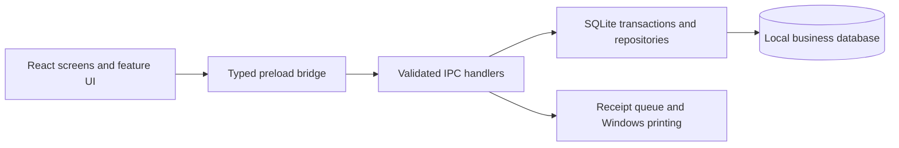

# Architecture and directory map

MALERA POS is an offline single-terminal app. The renderer owns interaction; the main process owns storage and printing.

## Application

| Directory                         | Responsibility                                              |
| --------------------------------- | ----------------------------------------------------------- |
| `src/app/`                        | App shell, shared data hooks and draft context              |
| `src/pages/`                      | Tables, inventory, reports and settings screens             |
| `src/components/common/`          | Shared controls, error boundary, data states and date input |
| `src/components/branding/`        | MALERA branding                                             |
| `src/components/floor-plan/`      | Artwork and interactive table positioning                   |
| `src/components/orders/`          | Draft editing and checkout                                  |
| `src/components/reservations/`    | Reservation dialog                                          |
| `src/components/inventory/`       | Product editor, supplies and stock losses                   |
| `src/components/finance/`         | Expenses and owner financial/cash controls                  |
| `src/components/receipts/`        | Print notices, actions and settings                         |
| `src/components/data-protection/` | Backup, restore and diagnostics                             |
| `src/domain/`                     | Business definitions, calculations and validation           |
| `src/presentation/`               | Floor geometry and display identities/calculations          |
| `src/types/`                      | Renderer API types and global declarations                  |
| `src/assets/`, `src/styles/`      | Images, CSS and design tokens                               |
| `electron/main/`                  | Startup/lifecycle, security, logging and data protection    |
| `electron/preload/`               | Restricted bridge exposed to the renderer                   |
| `electron/ipc/`                   | Main-process request registration/validation                |
| `electron/database/`              | Schema, repositories, transactions, backups and recovery    |
| `electron/receipts/`              | Receipt rendering, persistence, queue and printer adapter   |
| `electron/verification/`          | Isolated QA entry points and fixtures                       |

## Tooling

`scripts/build/` bundles Electron and rebuilds patched SQLite. `scripts/dev/` launches development. `scripts/qa/` runs verification scenarios. `scripts/release/` packages and inspects installers. `scripts/update/` implements the independent update broker. Shared utilities, fixtures and native helpers live in `scripts/lib/`, `scripts/fixtures/` and `scripts/windows/`.

`tests/` contains domain, storage, IPC and reliability tests; shared assertions live in `tests/support/`. Update-client tests use Node's runner and `.node.mjs` names to stay outside Vitest discovery.

Two workflows remain active: `ci.yml` validates changes and `desktop-updates.yml` builds/tests/publishes updates from `main`. Historical experimental workflows were archived with the old history.

## Documentation and storage

`docs/guides/` serves operators/owners; `docs/architecture/` records contracts; `docs/release/` describes current delivery; `docs/history/` retains earlier context.

Business data stays in `%APPDATA%\FOX Kafeteri`, outside the checkout. This legacy path, executable/package names and app ID remain stable for compatibility; product branding is MALERA POS.

`build/` contains tracked installer resources. `dist/`, `dist-electron/`, `work/`, `outputs/`, `release/` and `node_modules/` are generated. Run scripts from the root; imports resolve relative to their file, while build-tool entry points resolve relative to the root.
